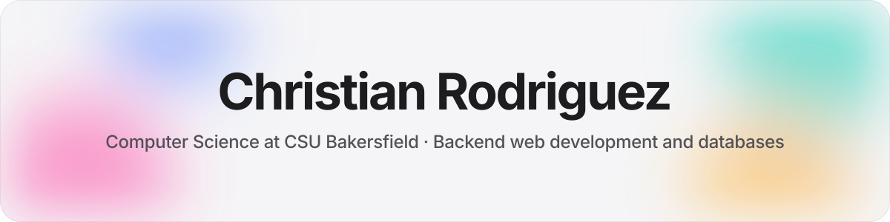
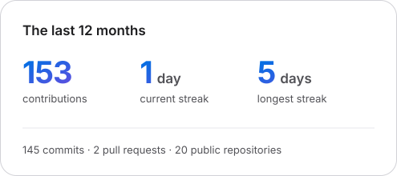
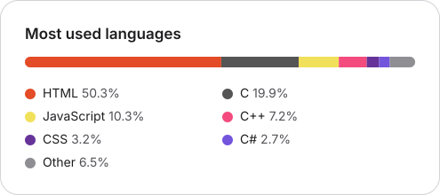
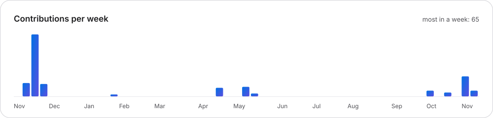

<picture>
  <source media="(prefers-color-scheme: dark)" srcset="assets/banner-dark.svg">
  
</picture>

### About me

I'm a Computer Science student at California State University, Bakersfield, with a concentration in
Information Systems, graduating in Fall 2026. My focus is backend web development and databases: PHP
and MySQL applications, REST and JSON APIs, and setting up and running Linux web servers.

Outside of class I have done undergraduate research with R and local language models, including a
co-authored, peer-reviewed article on air pollution exposure.

**[Portfolio](https://christianrodriguez46.github.io/)** ·
**[CV (PDF)](https://christianrodriguez46.github.io/resume/Christian_Rodriguez_Resume.pdf)** ·
**[Research article](https://doi.org/10.1088/2752-5309/ae4134)** ·
**[Contact](https://christianrodriguez46.github.io/#contact)**

 

### Featured projects

| Project | What it is | Links |
| :--- | :--- | :--- |
| **Breakaway** | A top-down hockey shootout against an AI goalie, drawn with JavaScript and Canvas: a fixed-timestep game loop, swept collisions and a goalie that decides as a state machine, tested with `node --test` and Playwright. | [Play](https://christianrodriguez46.github.io/Projects/Breakaway/) · [Code](https://github.com/ChristianRodriguez46/Breakaway) |
| **Portfolio site** | My site, hand-built with plain HTML, CSS and JavaScript: a page for every lab and project, a canvas ink background on the homepage, and page details for search and link previews. | [Visit](https://christianrodriguez46.github.io/) · [Code](https://github.com/ChristianRodriguez46/ChristianRodriguez46.github.io) |
| **Coursework** | Labs and projects from thirteen computer science courses at CSU Bakersfield, each with a page that explains what the program does and how to run it. | [Browse](https://christianrodriguez46.github.io/Coursework/) · [Code](https://github.com/ChristianRodriguez46/ChristianRodriguez46.github.io/tree/main/Coursework) |
| **Hangman** | A word-guessing game built with HTML, CSS and JavaScript. | [Play](https://christianrodriguez46.github.io/Projects/Hangman/) · [Code](https://github.com/ChristianRodriguez46/ChristianRodriguez46.github.io/tree/main/Projects/Hangman) |

### Languages and tools

**Languages**

  
  
  
  
  
  
  
  
  
  
  

**Web and databases**

  
  
  

**Systems and tools**

  
  
  
  
  
  
  

### GitHub activity

  <picture>
    <source media="(prefers-color-scheme: dark)" srcset="profile/stats-dark.svg">
    
  </picture>
  <picture>
    <source media="(prefers-color-scheme: dark)" srcset="profile/languages-dark.svg">
    
  </picture>

<picture>
  <source media="(prefers-color-scheme: dark)" srcset="profile/activity-dark.svg">
  
</picture>
